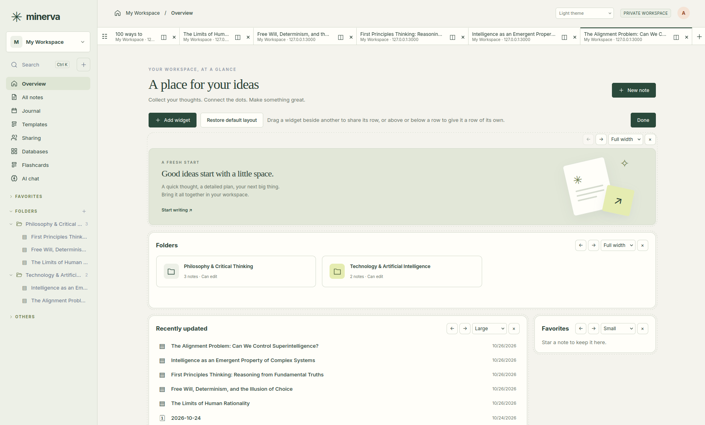

<div align="center">

# 

### A home for everything you’re learning.

Write freely. Connect ideas. Learn with AI. Build something together.

**A free, open-source workspace for your notes, knowledge, and next big idea.**

[Explore Minerva](https://akaped.github.io/minerva/) · [Get started](#get-started) · [Contribute](CONTRIBUTING.md) · [Report a problem](https://github.com/akaped/minerva/issues)




</div>

---

You read something worth remembering. A conversation sparks an idea. A video finally makes a difficult topic click. Then life moves on, and the good stuff gets scattered across tabs, files, and forgotten notes.

**Minerva gives those ideas somewhere to grow.** Capture a thought, connect it to what you already know, ask an AI to help you understand it, and share the result with the people who need it.

## Open, in every sense

- **Free and open source.** Minerva is released under the MIT License. Use it, study it, change it, share it.
- **Yours to run.** Keep it on your own computer, or host it on your own server for your family, class, or team. There is no account to create with us and no subscription.
- **Your notes stay yours.** Export everything to Markdown, a ZIP for Obsidian or Joplin, HTML, or PDF, whenever you like.
- **Built in the open.** The roadmap, the design decisions, and the discussions are public, and anyone can take part.

> **Early access:** Minerva is usable every day and improving quickly. We welcome people who try it, tell us what gets in the way, and help make it better. It is not yet hardened for large organizations.

## What you’ll find inside

### Write the way you think

Every paragraph is a block you can move, nest, and rearrange. Mix notes with checklists, tables, images, code, diagrams, equations, callouts, and YouTube videos that play right in the page. Start from a template, or keep a daily journal where unfinished tasks follow you to the next day. When you need quiet, switch to focus mode.

### Connect what you know

Link notes to each other and see which pages point back. Organize with folders, tags, and favorites, and search everything you can access. Open several notes as tabs, two of them side by side.

For things that belong in a list, use tables and boards: reading lists, research collections, project trackers. Drop them straight into a note.

### An AI that works beside you

Click **Ask AI** in a note and a chat opens next to it, already knowing what the note says.

- **Answers become notes.** Replies arrive as ready-made blocks: add one, or the whole answer, to your note with a click, save it as a new note, or copy it.
- **Research beyond your notes.** Ask about something new and the AI answers from what it knows and, if your administrator allows it, searches the web and lists its sources.
- **Your choice of model.** OpenAI, Anthropic Claude, DeepSeek, or any compatible service, including models you run yourself. AI is optional: ordinary note-taking never needs it, and it only sees what you can see.

The optional **Superhuman Learning** plugin goes further:

| Start with                  | What you can do                                                  |
| --------------------------- | ---------------------------------------------------------------- |
| A selection, block, or note | Summarize it or pull out insights, concepts, and questions.      |
| A YouTube video             | Import its captions with timestamps and jump back to the moment. |
| An audio recording          | Transcribe it with a transcription service you choose.           |

You stay in charge: preview the result, edit it, and keep only what’s useful. [How to install it →](#add-the-learning-plugin)

### Remember what you learn

Create personal flashcard decks and test yourself with spaced-repetition reviews. Write your own cards, or ask AI to draft them from a note, a folder, or web research on a topic. Check the sources, edit the questions and answers, and save only the cards you want. [Flashcards guide →](docs/flashcards.md)

### Think together

Edit the same note at the same time and see who else is there. Decide who can view or edit each workspace, folder, or note. Share a link when someone needs a quick way in, and switch it off when you’re done. Assign a task to a teammate with `/assigntouser` and they get an email; set a reminder with `/remindme` and the block lands in your inbox when it’s due. [Email setup →](docs/setup.md#email)

### Share your work with the world

Publish notes as clean public pages, a blog, or a wiki, with videos and images included. Export a print-ready PDF from 20 templates, from meeting minutes to a polished report. Give a note your own details, like `{{company}}` or `{{author}}`, and the templates place them on the cover and in the headers.

### Works offline

The desktop app for Windows, macOS and Linux keeps your personal notes on your computer and works without a connection. It can also keep offline copies of your team’s workspaces: edit them on a plane, and Minerva merges your changes with everyone else’s when you’re back online.

### Make it yours

Pick light, dark, colorful, or a retro command-line theme, and give your published pages their own look. Themes, PDF templates, and plugins are simple files you can add or write yourself. Two-step sign-in keeps accounts safe.

## A few things you could make

- **A learning notebook:** video transcripts, sources, explanations in your own words, and the questions you still want to answer.
- **A research companion:** ask the AI to dig into a topic, keep the best parts as notes, and link them to what you already know.
- **A shared project room:** plans, checklists, trackers, and meeting notes in one place.
- **A small public knowledge garden:** turn selected notes into a blog or wiki while the rest stays private.

## Get started

### Which way is right for you?

| You want…                                                    | Choose                                              |
| ------------------------------------------------------------ | --------------------------------------------------- |
| Minerva in your browser, from anywhere, alone or with others | [Your own Minerva server](#your-own-minerva-server) |
| Notes on your own computer, also without internet            | [The desktop app](#the-desktop-app)                 |

Both work together: the desktop app can connect to your server and keep offline copies.

### Your own Minerva server

You need a computer or rented server that stays on, with [Docker](https://docs.docker.com/get-started/get-docker/) installed.

**1. Download Minerva**

```sh
git clone https://github.com/akaped/minerva.git
cd minerva
cp .env.example .env
```

**2. Fill in your settings.** Open the new `.env` file in any text editor and change the lines marked **CHANGE**:

- your email and a password of at least 12 characters, for the first administrator account;
- the address people will use, such as `https://notes.example.com`;
- how Minerva reaches the internet: `https` gets a free certificate automatically. Can’t open ports? [`deploy/compose.yaml`](deploy/compose.yaml) runs the published image with an optional Cloudflare Tunnel.

Just trying it on your own computer? Set `COMPOSE_PROFILES=`, `MINERVA_PUBLIC_URL=http://localhost:3000`, and `MINERVA_SECURE_COOKIE=0`.

**3. Start it**

```sh
docker compose up -d --build
```

The first start builds Minerva and takes a few minutes; to skip that, set `MINERVA_IMAGE=ghcr.io/akaped/minerva:latest` in `.env` and run `docker compose pull && docker compose up -d` instead. Then open your address (or **http://localhost:3000**) and sign in.

**4. Finishing touches.** Remove the password from `.env`: it was only needed once. Add accounts for other people under _Server administration_, and set up an AI provider under _AI providers_ if you want one.

To update later: `git pull`, then `docker compose up -d --build`. Back up the `minerva_minerva-data` Docker volume regularly; [here’s how](docs/setup.md#docker).

### Add the learning plugin

The **Superhuman Learning** plugin (`/summary`, `/wisdom`, `/youtube`, `/transcribe`) is a folder of Python scripts. The standard image stays minimal, so it contains neither Python nor the plugin; on a Docker server you add both:

**1. Copy the plugin** from this repository next to your `compose.yaml`, so the server has `plugins/server/superhuman-learning/`:

```sh
scp -r plugins/server/superhuman-learning you@server:minerva/plugins/server/
```

**2. Add Python** with a `Dockerfile` next to `compose.yaml` (leave out the `yt-dlp` line if you don’t need `/youtube`):

```dockerfile
FROM ghcr.io/akaped/minerva:latest
USER root
RUN apt-get update \
 && apt-get install -y --no-install-recommends python3 python3-venv \
 && python3 -m venv /opt/minerva-media \
 && /opt/minerva-media/bin/pip install --no-cache-dir yt-dlp \
 && rm -rf /var/lib/apt/lists/*
ENV MINERVA_PLUGIN_PYTHON=/opt/minerva-media/bin/python
USER minerva
```

**3. Use it in `compose.yaml`:** build that image and mount the plugins folder in the `minerva` service:

```yaml
services:
  minerva:
    build: .
    image: minerva-learning:latest
    volumes:
      - minerva-data:/data
      - ./plugins:/plugins:ro
```

**4. Start it** with `docker compose build --pull && docker compose up -d`, and run the same command to update later. Then type `/` in an empty block of a note: the four commands appear.

Text commands use the AI provider you set up under _AI providers_. For `/transcribe`, also add `MINERVA_ASR_PROVIDER` (the provider profile’s ID) and `MINERVA_ASR_MODEL` (a model that returns timestamped segments) to `.env`. Without Docker, install Python 3 (and `yt-dlp`) on the server and put the folder in Minerva’s plugins directory. [Every option and limit →](plugins/server/superhuman-learning/README.md)

### The desktop app

Download it from the [Releases page](https://github.com/akaped/minerva/releases):

- **Windows:** unzip `minerva-desktop-…-windows-x86_64.zip` and run `Minerva.exe`. Windows 10 and 11 include everything it needs.
- **Linux:** unpack `minerva-desktop-…-linux-x86_64.tar.gz` and run `./install.sh`, which adds Minerva to your applications. It needs WebKitGTK 4.1, already installed on most desktops.
- **macOS** (11 or later, Apple Silicon and Intel): unzip `minerva-desktop-…-macos-universal.zip` and drag `Minerva.app` to Applications. It isn't notarized by Apple yet, so the first time, right-click it and choose **Open**.

Or build it from its source code:

1. Install [Rust](https://www.rust-lang.org/tools/install).
2. On Linux, also install the WebKitGTK 4.1 and GTK 3 development packages (Fedora: `webkit2gtk4.1-devel gtk3-devel`; Debian or Ubuntu: `libwebkit2gtk-4.1-dev libgtk-3-dev`).
3. In the `minerva` folder, run `cargo run --release -p minerva-desktop`.

The app opens straight to your personal notes. To connect a server, press <kbd>Ctrl</kbd>+<kbd>Shift</kbd>+<kbd>O</kbd>. [Desktop app guide →](docs/desktop.md)

**More detail:** [Full setup, HTTPS, and backups](docs/setup.md) · [Offline copies and sync](docs/sync.md) · [Development guide](CONTRIBUTING.md#development-setup)

## Help make Minerva better

Our ambition is simple: **make the place where people keep their knowledge feel as useful as the knowledge itself.** That takes more than code. It takes good writing, thoughtful design, and people willing to say what isn’t working.

You don’t need to be a programmer to contribute:

- Try it for something real and tell us where you got stuck.
- Improve a guide, or share a useful template or theme.
- Test it with a keyboard, a screen reader, or a different device.
- Help with translations and clearer wording.
- Suggest a simpler experience, or help build it.

[Read the contribution guide](CONTRIBUTING.md) · [Browse issues](https://github.com/akaped/minerva/issues) · [Suggest an improvement](https://github.com/akaped/minerva/issues/new?template=feature_request.yml)

Small, focused contributions are welcome; for larger changes, open an issue first so we can agree on the approach. A star helps others find the project.

## What’s still growing

- **In the browser, Minerva needs a connection.** For offline work, use the desktop app.
- **Desktop installers** (MSI, Flatpak) and automatic updates are not available yet; the app comes as a ZIP or tar archive.
- **Large teams and very large collections** need more performance work.
- **AI features** depend on the provider you configure, and their answers still need your judgment.
- **Not yet available:** flashcards and spaced repetition, end-to-end encryption, single sign-on, email invitations, and password reset by email.

The [roadmap](TODO.md) and [architecture notes](docs/architecture.md) go into more depth.

## Documentation

[Setup and operations](docs/setup.md) · [Desktop app](docs/desktop.md) · [Offline sync](docs/sync.md) · [Sharing and publishing](docs/sharing.md) · [Connect external AI tools (MCP)](docs/mcp.md) · [Themes, templates, and plugins](plugins/README.md) · [API reference](docs/api.md)

## License

Minerva is free software under the [MIT License](LICENSE): you may use, study, modify, and share it. Third-party components keep their own licenses; see [THIRD_PARTY_NOTICES.md](THIRD_PARTY_NOTICES.md).

Independently authored. Built in the open. Better with you.
