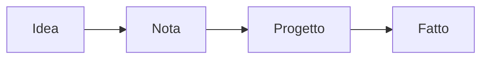

Benvenuto! Questa nota è la tua guida a Minerva. È una nota normale in **Il mio spazio di lavoro**, che solo tu puoi vedere: prova tutto qui, modificala, rompila, eliminala quando non ti serve più.

> [!TIP]
> Ogni paragrafo che vedi è un **blocco**. Fai clic su un blocco per modificarlo, fai clic fuori (o premi **Esc**) per vedere il risultato.

## 1. Scrivere

Le note di Minerva si scrivono in Markdown, e appaiono formattate appena lasci un blocco. Alcuni esempi, scritti esattamente come li digiteresti:

| Scrivi | Ottieni |
| --- | --- |
| `**grassetto**` e `*corsivo*` | **grassetto** e *corsivo* |
| `==evidenziato==` | ==evidenziato== |
| `~~fatto~~` | ~~fatto~~ |
| `` `codice` `` | `codice` |
| `[un link](https://example.com)` | [un link](https://example.com) |

- **Invio** divide un blocco al cursore; **Maiusc+Invio** va a capo dentro il blocco.
- **Backspace** all’inizio di un blocco lo unisce a quello sopra.
- **↑ / ↓** sulla prima o sull’ultima riga passano al blocco vicino.
- **Ctrl+Z** e **Ctrl+Maiusc+Z** annullano e ripetono.

## 2. Il menu /

In un blocco vuoto, scrivi **/** per inserire qualsiasi cosa: titoli, attività, elenchi, citazioni, codice, tabelle, immagini e file, riquadri, formule, diagrammi, un database in tempo reale, un link a un’altra nota, un’assegnazione o un promemoria. Il menu si apre accanto al blocco, raggruppato per tipo, con la scorciatoia Markdown di ciascuno. Inizia a scrivere per filtrare l’elenco, per esempio `/table` o `/remindme`. **Immagine o file** apre un riquadro in cui trascinare i file o fare clic per sceglierli.

Un indirizzo web scritto in un blocco, come https://example.com, diventa un link. Incolla un indirizzo sopra del testo selezionato per collegare quel testo.

Seleziona del testo e premi **Ctrl+Maiusc+P** per i comandi che agiscono sulla selezione.

## 3. Titoli, elenchi e attività

### Un titolo con tre #

- Un elenco puntato inizia con `- `
- Rientra di due spazi per annidare
  - così

1. Gli elenchi numerati iniziano con `1. `
2. e contano da soli

- [ ] Un’attività inizia con `- [ ] `. Fai clic sulla casella per spuntarla.
- [x] Le attività spuntate appaiono così.

## 4. Organizzare con i blocchi

Passa sopra un blocco per vedere la sua maniglia **⠿** nel margine sinistro: trascinala per spostare il blocco in su o in giù, o fai clic per copiare un link al blocco o incorporarlo altrove; usa **×** per eliminarlo. Puoi anche raggiungere la maniglia con **Tab** e spostare il blocco con le frecce.

Seleziona del testo su più blocchi e premi **Ctrl+C**: gli editor di testo semplice ricevono il Markdown, mentre Word, Docs o un’email ricevono il testo formattato.

## 5. Link, tag e collegamenti inversi

Scrivi `[[` per collegare un’altra nota: sceglila dall’elenco. Scrivi `![[` per mostrarla dentro questa, sempre aggiornata. L’altra nota mostra questa in fondo, sotto **Collegata da**.

Scrivi # e una parola ovunque, come `#idee` o `#progetto/minerva`, per assegnare un tag a una nota. Fai clic su un tag per vedere tutte le note che lo hanno; aggiungi tag all’intera nota con **+ Aggiungi tag** sotto il titolo.

## 6. Riquadri, citazioni e codice

> Una citazione inizia con `> `.

> [!NOTE]
> I riquadri iniziano con `> [!NOTE]`, `> [!TIP]` o `> [!WARNING]`.

> [!WARNING]
> Usali per le cose che nessuno dovrebbe perdersi.

```rust
// I blocchi di codice iniziano con tre apici inversi e il nome del linguaggio.
fn main() {
    println!("Ciao da Minerva");
}
```

## 7. Formule e diagrammi

Le formule usano LaTeX tra `$$`:

$$
E = mc^2 \qquad \int_0^1 x^2\,dx = \frac{1}{3}
$$

I diagrammi usano Mermaid in un blocco di codice chiamato `mermaid`:



## 8. Immagini, file e video

Usa **/ → Immagine o file** (fino a 60 MB ciascuno), incolla un’immagine mentre modifichi un blocco, o trascina immagini e file sulla nota. Scrivi **/emoji** per cercare e inserire qualsiasi emoji; fai clic sull’icona della nota per cambiarla allo stesso modo. Incolla il link a un’immagine e compare nella pagina. Ogni file appare come una scheda con tipo, dimensione e data; un PDF si apre accanto alla nota con **Apri**. Tutti i file della nota sono elencati anche in **File** nel menu ⋯ della barra.

Incolla il link a un file audio (`.mp3`, `.wav`, `.ogg`...) e diventa un lettore. **/ → Registra audio** registra dal microfono e salva la registrazione nella nota, con un lettore; con un servizio di trascrizione, **Trascrivi e riassumi** ne ricava punti chiave e azioni da fare.

Incolla da solo in un blocco un link di YouTube e diventa un lettore che continua a suonare mentre scrivi. Con il plugin per l’apprendimento, `/youtube` importa anche i sottotitoli con i tempi.

## 9. Lavorare con altre persone

- **Condividi** dà accesso a una nota ad altri membri di questo server, o crea un link per chiunque. Spazi di lavoro e cartelle si condividono dal loro menu **⋯**.
- Chi modifica una nota nello stesso momento vede le modifiche degli altri in tempo reale.
- Un’etichetta con il nome accanto a un blocco mostra chi ci sta lavorando, piena mentre lo modifica. Un blocco che qualcun altro sta modificando non si può aprire finché non ha finito, così due persone non si sovrascrivono mai la stessa riga.
- Scrivi **@** e un nome per menzionare qualcuno che può aprire la nota: sceglilo dall’elenco e il suo nome compare nel blocco. Riceve un’email con il blocco e un link alla nota, e lo trova nel widget **Menzioni** della sua Panoramica.
- **/remindme** chiede una data e un’ora e le aggiunge al blocco, come `⏰2026-11-02 09:00`. A quell’ora ricevi il blocco via email. Togli il `⏰` per annullare.
- **Promemoria** nella barra laterale elenca tutto ciò che arriva nello spazio di lavoro: le ore `⏰` nelle sue note e i promemoria dello spazio di lavoro. Aggiungine uno con **Nuovo promemoria**, una volta sola o ripetuto («Assicurazione auto, ogni anno»), con una categoria come *auto* o *salute* per filtrare. **Fatto** sposta un promemoria ripetuto alla volta successiva. In uno spazio di lavoro condiviso, tutti ne vedono i promemoria e ricevono un’email quando uno scade. **Aggiungi al tuo calendario** li mostra nella tua app di calendario.

Il mio spazio di lavoro è privato e non si può condividere: crea un nuovo spazio di lavoro dal menu degli spazi di lavoro per lavorare in team.

## 10. Il tuo spazio di lavoro, a modo tuo

- **Panoramica** è la tua bacheca. Scegli **Personalizza** per aggiungere widget (note preferite, modifiche recenti, il calendario del diario, flashcard da ripassare, grafici da un database), trascinali in righe e ridimensionali.
- **Diario** ti dà una nota al giorno. I **Modelli** sono note da cui partire per altre note, con **Compila da modello**.
- I **Database** sono tabelle di record con testo, numeri, date, caselle, scelte e link. Mostrane uno dentro una nota con **/ → Database (in tempo reale)**.
- Le **Flashcard** sono mazzi da studiare con la ripetizione dilazionata. Scrivi le schede, importa mazzi di Anki, o chiedi all’IA di prepararle dalle tue note.
- **☆** nella barra aggiunge una nota ai Preferiti nella barra laterale.

## 11. IA

Quando l’amministratore ha configurato un fornitore di IA, **Chat IA** nella barra laterale risponde a qualsiasi domanda: parte con **Nessun contesto**, quindi nessuna delle tue note viene inviata. Allega foto, scansioni, PDF o documenti di testo con 📎, trascinandoli sulla casella della domanda o incollando un’immagine, e fai domande su di essi. Scegli come contesto uno spazio di lavoro, una cartella o una nota per chiedere delle tue note. **Chiedi all’IA** nella barra apre una chat accanto alla nota, su quella nota. Ogni risposta è fatta di blocchi: aggiungine uno o tutti alla nota, salva la risposta come nuova nota, o copiala. **Chat IA** nella barra laterale conserva tutte le tue conversazioni.

## 12. Esportare, stampare e pubblicare

- **Esporta** salva una nota come PDF, HTML, Markdown o uno zip con i suoi file. I modelli PDF le danno una copertina e un’impaginazione.
- **Dettagli del documento** contiene le tue variabili (autore, versione, cliente...). Scrivi `{{author}}` in una nota e le esportazioni mostrano il valore.
- **Condividi → Pubblica sul web** mette una nota sul web come pagina pubblica, che puoi ritirare in qualsiasi momento.

## 13. Scorciatoie

| Scorciatoia | Cosa fa |
| --- | --- |
| **Ctrl+K** | Cerca in tutte le note |
| **Ctrl+F** | Trova e sostituisci in questa nota |
| **Ctrl+Maiusc+F** | Modalità concentrazione, senza menu |
| **Ctrl+Maiusc+P** | Comandi sul testo selezionato |
| **/** | Inserisci un blocco |
| **Ctrl+Z / Ctrl+Maiusc+Z** | Annulla / ripeti |

## 14. Il tuo account

Il tuo nome in fondo alla barra laterale apre il tuo account: cambia la password, attiva la verifica in due passaggi con un’app di autenticazione, scegli la lingua ed esci. Password dimenticata? Usa **Password dimenticata?** nella pagina di accesso, se il tuo server invia email.

---

Tutto qui. Inizia con una nuova nota (**+** accanto a una cartella, o **Nuova nota** nella Panoramica) e rendi tuo questo posto.
