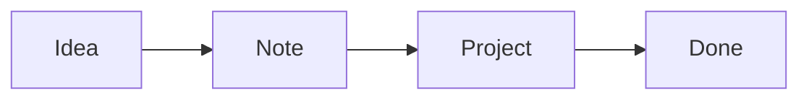

Welcome! This note is your guide to Minerva. It is an ordinary note in **My Workspace**, which only you can see, so try everything right here: edit it, break it, delete it when you no longer need it.

> [!TIP]
> Every paragraph you see is a **block**. Click one to edit it, click outside (or press **Escape**) to see the result.

## 1. Writing

Minerva notes are written in Markdown, and shown formatted as soon as you leave a block. Some examples, written exactly as you would type them:

| You type | You get |
| --- | --- |
| `**bold**` and `*italic*` | **bold** and *italic* |
| `==highlight==` | ==highlight== |
| `~~done~~` | ~~done~~ |
| `` `code` `` | `code` |
| `[a link](https://example.com)` | [a link](https://example.com) |

- **Enter** splits a block at the cursor; **Shift+Enter** adds a line break inside it.
- **Backspace** at the start of a block joins it with the one above.
- **↑ / ↓** at the first or last line move to the neighbouring block.
- **Ctrl+Z** and **Ctrl+Shift+Z** undo and redo.

## 2. The / menu

In an empty block, type **/** to insert anything: headings, tasks, lists, quotes, code, tables, images and files, callouts, math, diagrams, a live database, a link to another note, an assignment or a reminder. Start typing to filter the list, for example `/table` or `/remindme`.

Select some text and press **Ctrl+Shift+P** for commands that work on the selection.

## 3. Headings, lists and tasks

### A heading with three #

- A bullet list starts with `- `
- Indent with two spaces to nest
  - like this

1. Numbered lists start with `1. `
2. and count by themselves

- [ ] A task starts with `- [ ] `. Click the box to tick it.
- [x] Ticked tasks look like this.

## 4. Organizing with blocks

Hover over a block to see its handle **⠿** in the left margin: drag it to move the block up or down, or use **×** to delete it. You can also focus the handle with **Tab** and move the block with the arrow keys.

Select text across several blocks and press **Ctrl+C**: plain-text editors get the Markdown, while Word, Docs or an email get the formatted text.

## 5. Links, tags and backlinks

Type `[[` to link to another note: choose it from the list. The other note shows this one under **Linked from**, at the bottom.

Type # and a word anywhere, like `#ideas` or `#project/minerva`, to tag a note. Click a tag to see every note that has it; add tags for the whole note with **+ Add tag** under the title.

## 6. Callouts, quotes and code

> A quote starts with `> `.

> [!NOTE]
> Callouts start with `> [!NOTE]`, `> [!TIP]` or `> [!WARNING]`.

> [!WARNING]
> Use them for the things nobody should miss.

```rust
// Code blocks start with three backticks and the language name.
fn main() {
    println!("Hello from Minerva");
}
```

## 7. Math and diagrams

Formulas use LaTeX between `$$`:

$$
E = mc^2 \qquad \int_0^1 x^2\,dx = \frac{1}{3}
$$

Diagrams use Mermaid in a code block named `mermaid`:



## 8. Images, files and videos

Use **/ → Image or file**, paste an image while editing a block, or drop images and files onto the note. Paste a link to an image and it shows in the page. Every file of the note is listed under **Files** in the toolbar.

Paste a link to an audio file (`.mp3`, `.wav`, `.ogg`...) and it becomes a player. **/ → Record audio** records from your microphone and saves the recording in the note, with a player.

Paste a YouTube link alone in a block and it becomes a player that keeps playing while you write. With the learning plugin, `/youtube` also imports its captions with timestamps.

## 9. Working with other people

- **Share** gives other members of this server access to a note, or creates a link for anyone. Workspaces and folders are shared from their **⋯** menu.
- Everyone editing a note at the same time sees each other's changes live.
- Type **@** and a name to mention someone who can open the note: pick them from the list and their name appears in the block. They get an email with the block and a link to the note, and find it in the **Mentions** widget of their Overview.
- **/remindme** asks for a date and time and adds it to the block, like `⏰2026-11-02 09:00`. At that time you get the block by email. Remove the `⏰` to cancel.

My Workspace is private and cannot be shared: create a new workspace from the workspace menu for team work.

## 10. Your workspace, your way

- **Overview** is your dashboard. Choose **Customize** to add widgets (favorite notes, recent changes, your journal calendar, flashcards to review, charts from a database), drag them into rows and resize them.
- **Journal** gives you one note per day. **Templates** are notes you start other notes from, with **Fill from template**.
- **Databases** are tables of records with text, numbers, dates, checkboxes, choices and links. Show one inside a note with **/ → Database (live)**.
- **Flashcards** are decks you study with spaced repetition. Write cards, import Anki decks, or ask the AI to draft them from your notes.
- **★** in the toolbar adds a note to Favorites in the sidebar.

## 11. AI

When your administrator has set up an AI provider, **Ask AI** in the toolbar opens a chat beside the note. Ask about this note, a folder or the whole workspace. Each reply is made of blocks: add one or all of them to the note, save the reply as a new note, or copy it. **AI chat** in the sidebar keeps all your conversations.

## 12. Export, print and publish

- **Export** saves a note as PDF, HTML, Markdown, or a zip with its files. PDF templates give it a cover and a layout.
- **Metadata** holds your own variables (author, version, client...). Write `{{author}}` in a note and exports show the value.
- **Share → Publish** puts a note on the web as a public page, which you can unpublish at any time.

## 13. Shortcuts

| Shortcut | What it does |
| --- | --- |
| **Ctrl+K** | Search every note |
| **Ctrl+F** | Find and replace in this note |
| **Ctrl+Shift+F** | Focus mode, without menus |
| **Ctrl+Shift+P** | Commands on the selected text |
| **/** | Insert a block |
| **Ctrl+Z / Ctrl+Shift+Z** | Undo / redo |

## 14. Your account

Your name at the bottom of the sidebar opens your account: change your password, turn on two-step verification with an authenticator app, and sign out. Forgot your password? Use **Forgot your password?** on the sign-in page, if your server sends email.

---

That's it. Start with a new note (**+** next to a folder, or **New note** on the Overview) and make this place yours.
